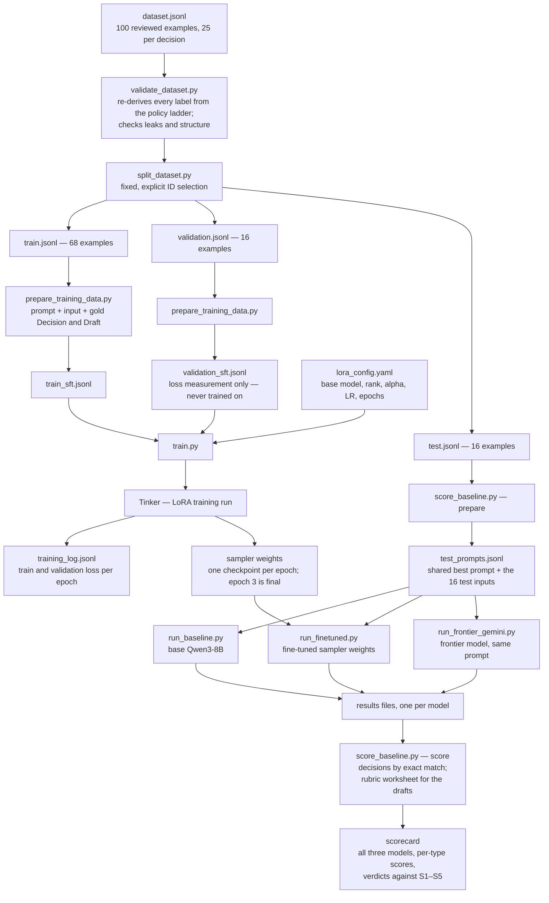
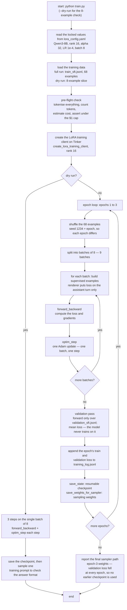

# Mermaid diagrams

Two diagrams for the repo README. Diagram 1 shows how one example moves
through every file in the project. Diagram 2 shows the training script,
step by step.

## Diagram 1 — one example through every file

## Diagram 2 — the training script, step by step

